

# Transformar Juntos

### A plataforma digital do evento **Transformar Juntos** · Sebrae
**02 e 03 de março de 2027 · Brasília/DF**

Site, aplicativo e painel de gestão, todos conectados ao mesmo banco de dados:
o que a organização publica aparece na hora para o público.

[**Abrir o site**](https://transformar-juntos-site.vercel.app) &nbsp;·&nbsp; [**Baixar o app Android (APK)**](#-baixar-o-app-android) &nbsp;·&nbsp; [**Enviar feedback**](../../issues/new/choose)

 

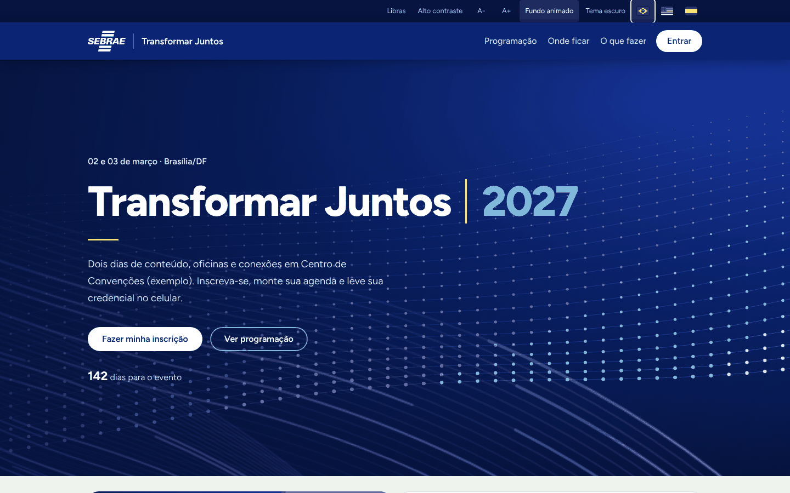

---

## Experimente agora

| | O que é | Como acessar |
|---|---|---|
| **Site** | Hotsite do evento e área do participante | https://transformar-juntos-site.vercel.app |
| **App Android** | Aplicativo para o dia do evento | [Baixar o APK](#-baixar-o-app-android) |
| **Painel de gestão** | Uso restrito da equipe organizadora | Apresentado nas imagens abaixo |

> Para testar o fluxo completo, crie uma conta no site (**Inscrição**) e entre com o mesmo e-mail e senha no app. A conta é a mesma nos dois.

---

## Baixar o app Android

<!-- APK-LATEST:START -->
**Versão mais recente: `transformar_juntos_2027.0.4.0.apk`** (app 0.4.0, gerado em 11/10/2026)

### [Baixar o APK](https://expo.dev/artifacts/eas/yd482jBgnrvFPV8Oe0nRmn7WzsB60_bPTR4CvGqDuX0.apk)

Link válido até **25/10/2026**. Depois dessa data, volte aqui: o link novo é publicado neste mesmo lugar.
<!-- APK-LATEST:END -->

**Como instalar**
1. Abra esta página no celular Android e toque em **Baixar o APK**.
2. Ao abrir o arquivo, o Android pede para permitir a instalação de **fontes desconhecidas**. Autorize só para o navegador que você usou.
3. Toque em **Instalar** e abra o app **Transformar Juntos**.

> O app é uma versão de teste. O Android pode exibir um aviso de segurança, o que é normal para apps instalados fora da loja.

### Histórico de versões

| Arquivo | Versão | Data | Novidades |
|---|---|---|---|
| `transformar_juntos_2027.0.4.0.apk` | 0.4.0 | 11/10/2026 | Home em bento grid, programação em linha do tempo, agenda (.ics), validação pública do certificado, mapa com zoom, QR e certificado renovados |
| `transformar_juntos_2027.0.3.1.apk` | 0.3.1 | 11/10/2026 | Build corrigido, com as mesmas novidades da 0.3.0 |
| `transformar_juntos_2027.0.3.0.apk` | 0.3.0 | 10/10/2026 | Tema neon, ícones e tela de abertura do evento, correção do fechamento ao abrir |
| `transformar_juntos_2027.0.2.1.apk` | 0.2.1 | 10/10/2026 | Correção do fechamento ao abrir em alguns aparelhos |

---

## O que a plataforma entrega

<table>
<tr>
<td width="33%" valign="top">

### Para o participante
- Programação por dia, com filtros
- Palestrantes e oficinas com vagas
- Agenda pessoal e lembretes
- **Credencial com QR**, que funciona sem internet
- Check-in por QR da sala e passaporte de estandes
- Conquistas, ranking e networking
- Avisos por push
- Avaliação do evento e **certificado em PDF**

</td>
<td width="33%" valign="top">

### Para a organização
- Gestão de programação, palestrantes e oficinas
- Credenciamento e leitura de QR na entrada
- Importação de inscritos por planilha
- Envio de avisos e notificações push
- Relatórios de presença e satisfação
- Assinaturas do certificado
- Perfis de acesso (admin e editor)

</td>
<td width="33%" valign="top">

### Para todos
- Site, app e painel sempre sincronizados
- Português, inglês e espanhol
- Tema claro, escuro e neon
- Acessibilidade: alto contraste, tamanho de fonte, VLibras
- Responsivo, de celulares a telas grandes
- Proteção de dados (LGPD): baixar e excluir os próprios dados

</td>
</tr>
</table>

---

## Site

Capa animada, programação, palestrantes, oficinas, **Como chegar** com mapa e rota, área do participante e certificado.

| Programação | Palestrantes |
|:---:|:---:|
| 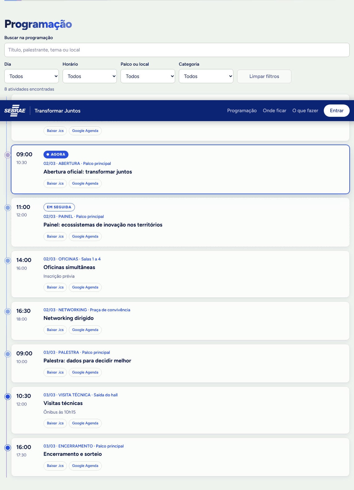 | 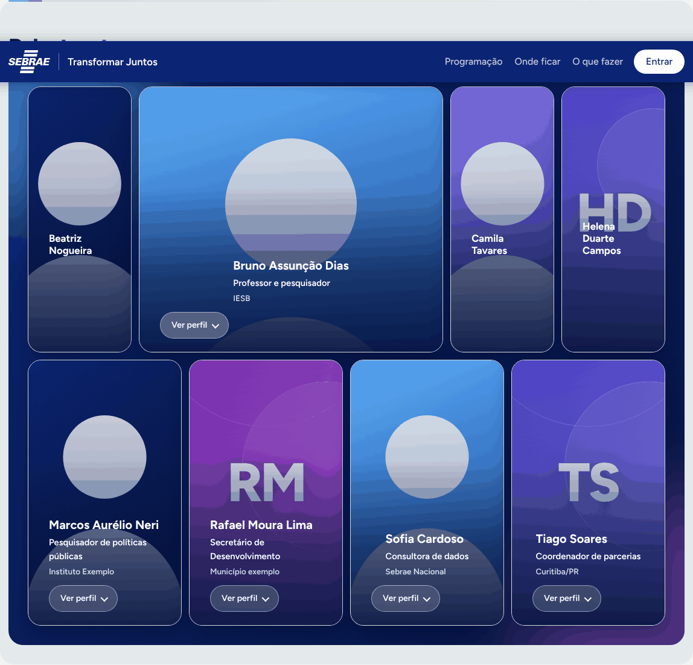 |
| **Oficinas** | **Como chegar** |
| 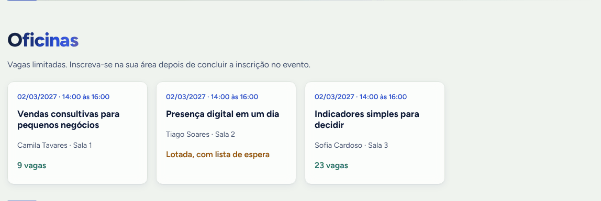 | 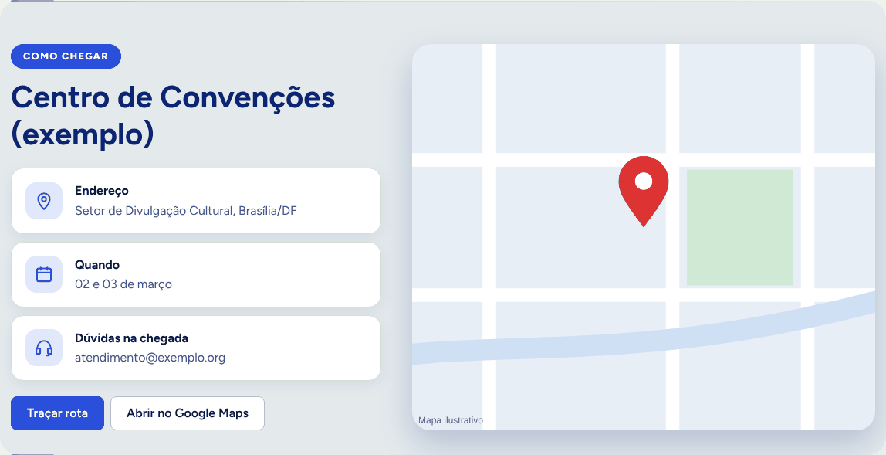 |
| **Minha área** | **Certificado** |
| 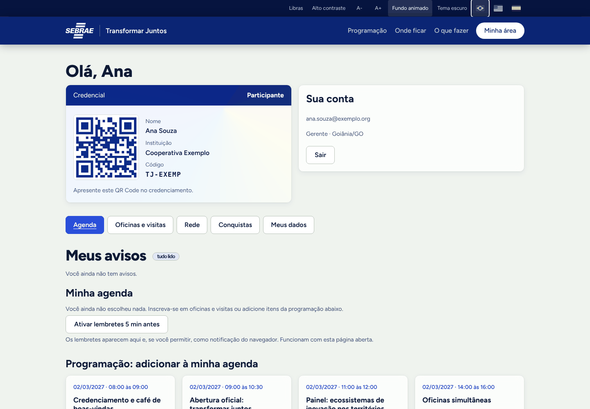 | 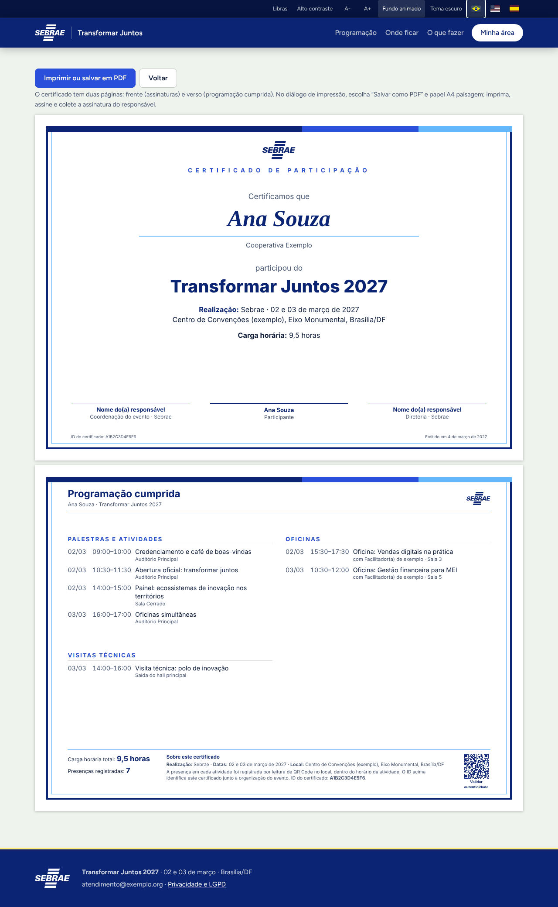 |

---

## Aplicativo

Um único código para **Android, iOS e web**. Abas fixas (Início, Programa, Oficinas, Rede e Acesso), credencial com QR e emissão de certificado no próprio aparelho.

| Início | Palestrantes | Acesso | Oficinas |
|:---:|:---:|:---:|:---:|
| 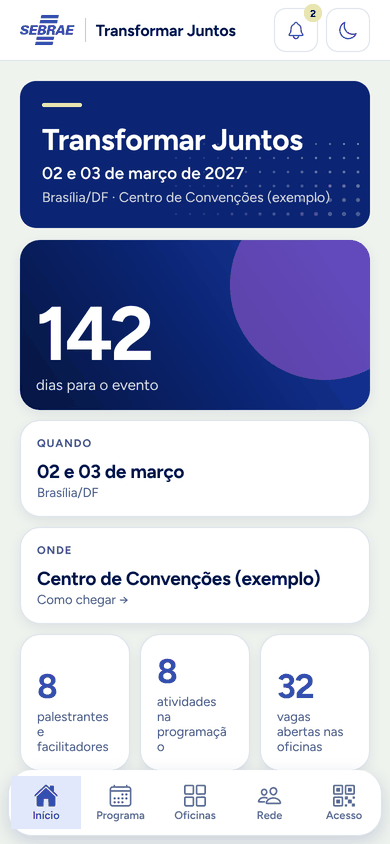 | 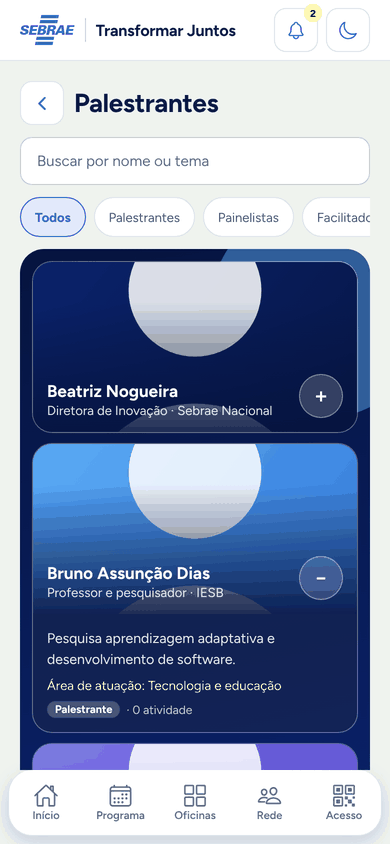 | 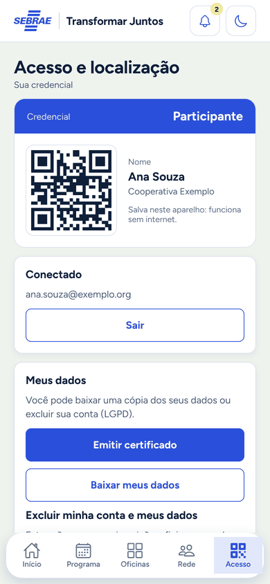 | 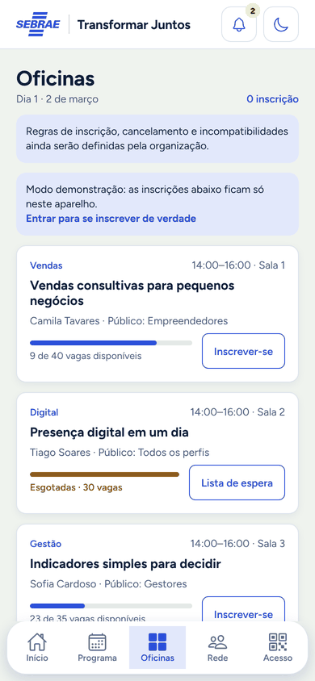 |
| **Tema escuro** | **Rede** | **Certificado** | |
| 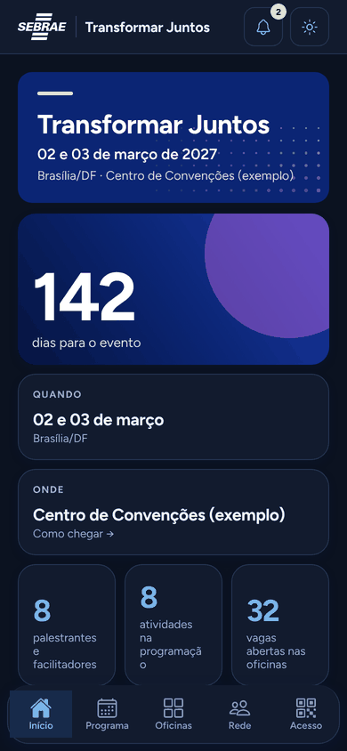 | 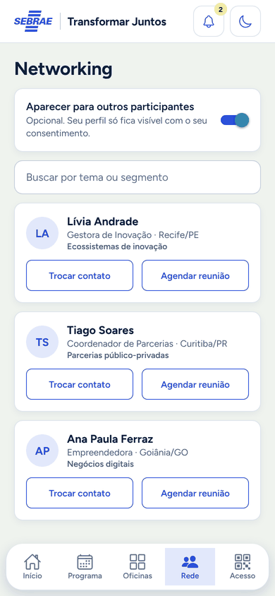 | 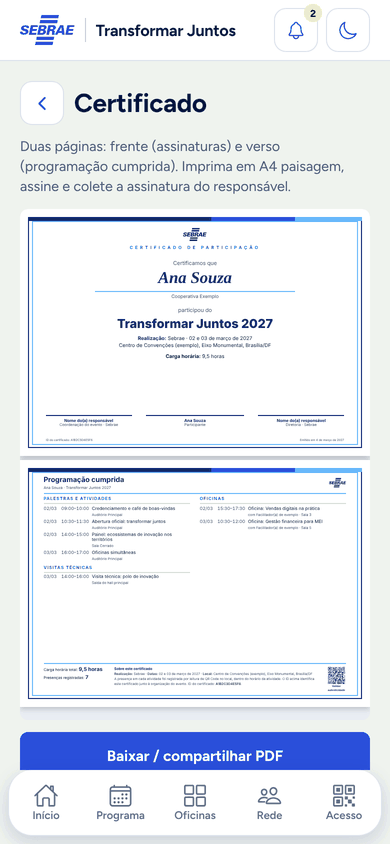 | |

---

## Painel de gestão

Ferramenta da equipe organizadora. Tudo o que é publicado aqui aparece no site e no app sem precisar atualizar nada.

| Programação | Credenciamento |
|:---:|:---:|
| 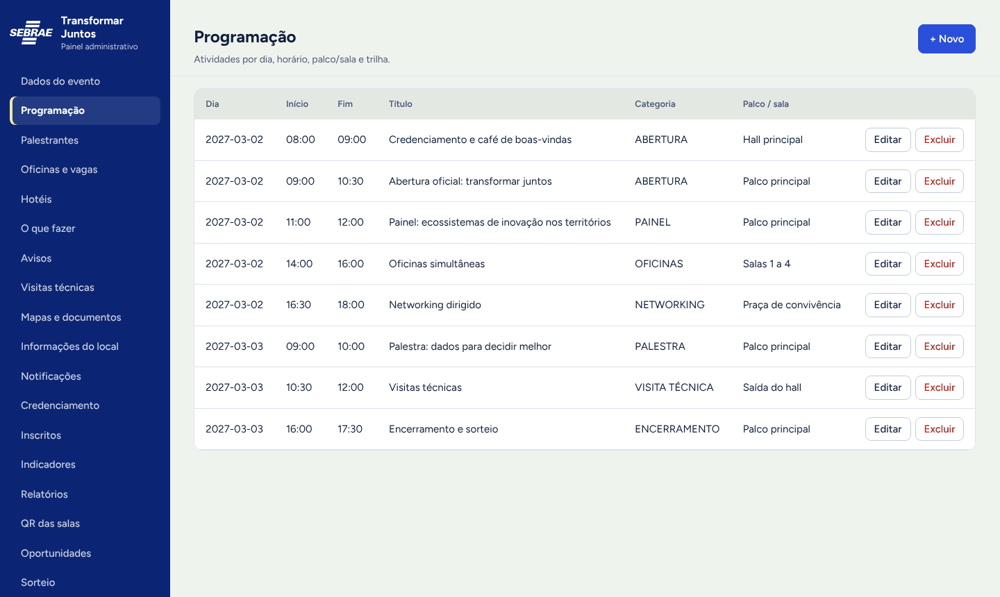 | 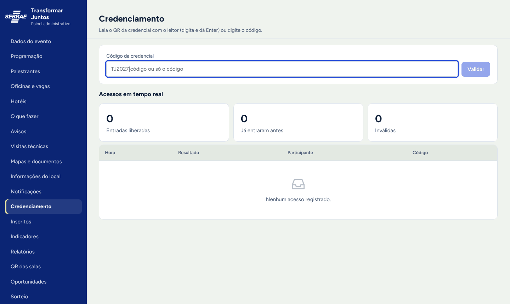 |
| **Inscritos** | **Notificações** |
| 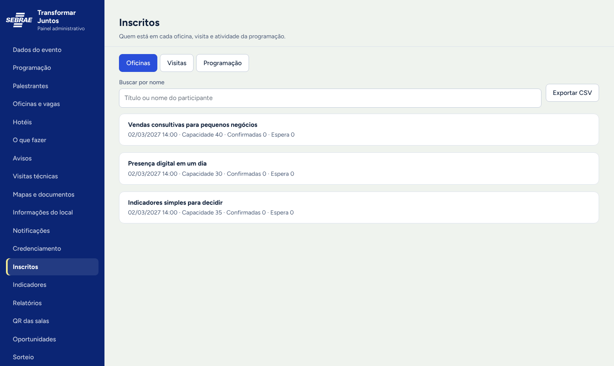 | 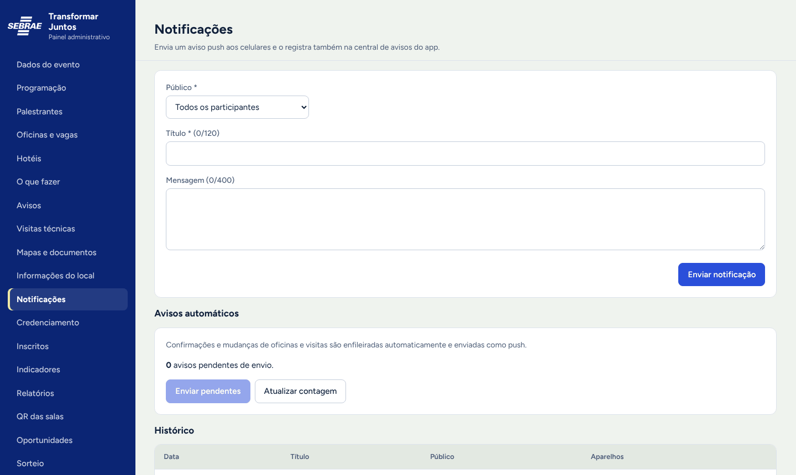 |
| **Relatórios** | |
| 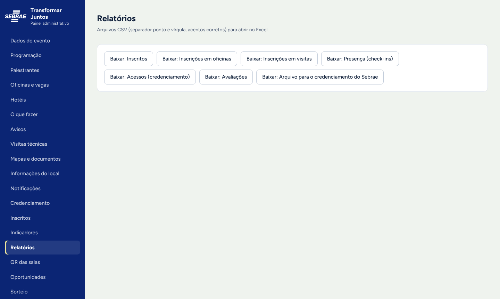 | |

> As imagens do painel usam **dados de exemplo (fictícios)**.

---

## Como funciona

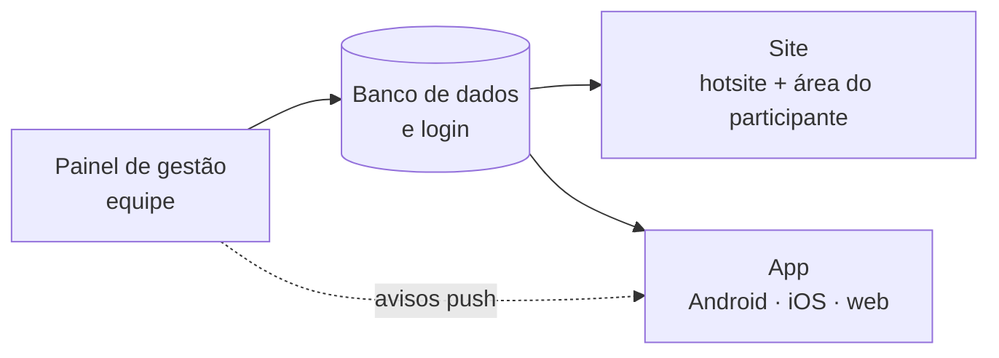

## Para testadores

Ao testar, repare e conte para a gente:
- **Instalação e abertura:** o app instalou e abriu sem fechar sozinho?
- **Fluxo principal:** inscrição, login, agenda, credencial com QR e certificado.
- **Leitura e visual:** textos, contraste e tema (claro, escuro e neon) no seu aparelho.
- **Desempenho:** algo lento, travando ou fora do lugar?

Envie pelo [**formulário de feedback**](../../issues/new/choose) informando o modelo do celular, a versão do Android e, se possível, um print.

---

Este repositório existe apenas para **divulgação e testes**. O código-fonte é mantido em repositório privado.

**Transformar Juntos** · Sebrae · 02 e 03 de março de 2027 · Brasília/DF

